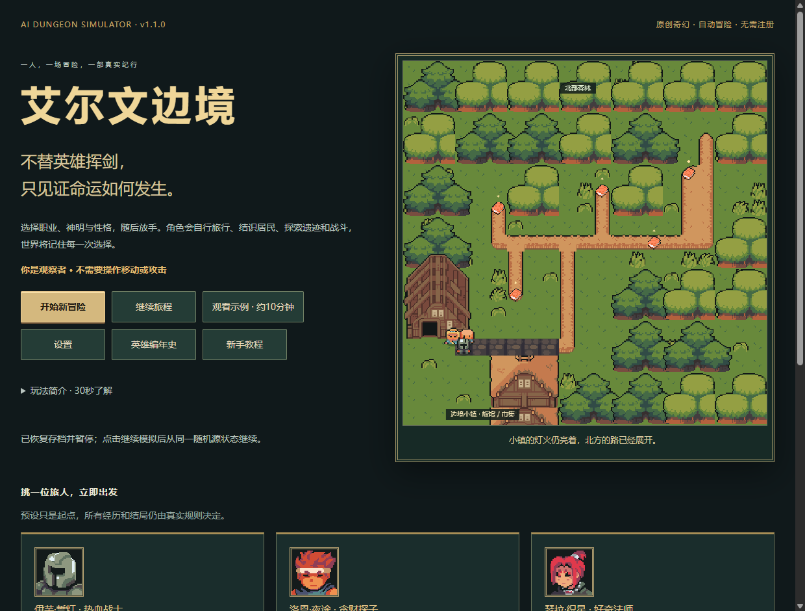
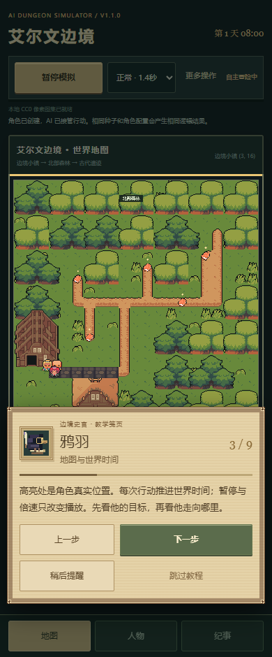
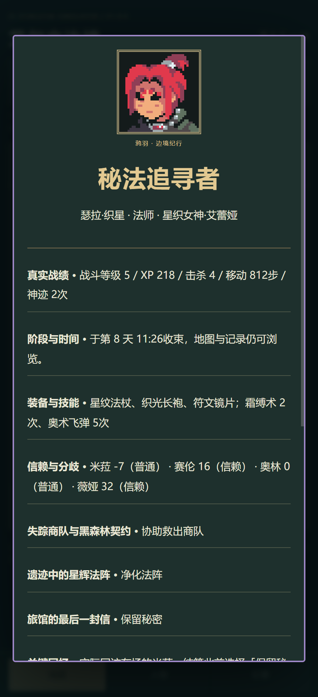

# AI Dungeon Simulator v1.1.0 · 玩家体验增强

一名拥有性格与目标的冒险者，在艾尔文边境自主旅行、处理事件、探索地牢、战斗与成长。你是观察者，创建角色后无需控制移动或攻击。原生HTML/CSS/JavaScript与Canvas，无注册、后端、付费API、CDN或运行依赖。

[在线游玩](https://chen-yy2008.github.io/ai-dungeon-simulator/) · [仓库](https://github.com/chen-yy2008/ai-dungeon-simulator) · [版本记录](CHANGELOG.md) · [本版验收](docs/releases/v1.1-report.md)

## 30秒上手

1. [打开在线网页](https://chen-yy2008.github.io/ai-dungeon-simulator/)，或直接用Chrome/Edge打开本地index.html。
2. 点击一张预设角色卡立即出发；想自行设定，选「开始新冒险」。不必填写高级JSON。
3. 跟随可跳过的鸦羽文字引导，观察角色自行移动、处理事件、战斗和换装。你只需暂停、倍速和翻阅记录。
4. 完成三线并返回小镇，或合理撤退/死亡后，会出现真实结算；「复制战报」「下载完整故事」可直接分享。

|一键预设|性格与神明|固定种子下实际体验|
|---|---|---|
|伊芙·誓灯 / 战士|善良勇敢，瓦尔铎|守护与援助，776行动得到边境守护者|
|洛恩·夜途 / 游荡者|贪婪且重退路，诺克斯|牟利与风险，852行动得到逐利旅人|
|瑟拉·织星 / 法师|好奇而节制，艾蕾娅|调查/有限魔法，906行动得到秘法追寻者|

预设不会直接发放结局或装备，以上结果由同版本真实规则跑出。姓名、职业、五项独立性格可自定，选择后自动绑定原创神明。不同种子或设定会产生不同结果。

正常播放每行动1.4秒，三预设约18～21分钟纯播放；慢速2.2秒、纪行0.6秒、快速60ms。「观看示例」使用稳定法师种子和纪行速度，约9分钟，也可立即快进。这是按实际行动数估算的节奏，不含读日志/教学暂停；浏览器后台可能降速。

手机底部切换地图/人物/纪事，「更多操作」保存/读取/回到开场/查看传记。localStorage自动保存在每25动作、暂停、退出和结局；手动存取同一槽，读取后暂停。新世界未开始前不覆盖旧存档。错误JSON、禁用存储或空间不足会提示，继续游戏仍可进行；无云同步。

## v1.1 史官笺页与英雄编年史

九段聚焦教学随真实冒险解锁：欢迎、职业神明、地图时间、人物卡、事件关系、地牢、战斗、成长、结局传记。羊皮纸对话框与原创像素鸦羽头像，高亮当前区域；支持上一步、永久跳过、稍后80次实际行动提醒。主菜单可重看，设置可重置；兼容旧版已完成/跳过状态，不强制重教老玩家。

设置可选完整/简洁/关闭旁白与视觉反馈。右侧关键卡片最多显示最近3条，附实际因果/事实ID；战斗卡说明谁行动、命中、伤害和实际技能结果。仅显示首次施展，不把开局已有技能谎称新学会。设置、叙事和名册不消费游戏随机数。

六预设补齐热血战士、谨慎卫士、贪财探子、狡黠游荡者、好奇法师、虔诚信徒；各有姓名、神明、五项性格、目标与真实起行宣言。新增布兰·石墙（谨慎战士/瓦尔铎）、希娅·薄雾（探索游荡者/诺克斯）、欧林·静烛（善良法师/艾蕾娅）使用同一官方CC0包的金甲、查访者、橙袍肖像和动画；只是外观，不额外赋予能力。

局后选录关键时间线、重要选择、代表交锋与鸦羽结语。英雄编年史本地保存最多30位，五种命运按真实结局解锁；同角色设定/种子/结果恢复不重复收录。冒险存档、观看设置、名册是独立数据；损坏旧名册不覆盖，存储受限时当前页面仍可看并下载传记。清理浏览器数据会丢失名册，没有云同步。

## v1.0开场、收束与分享

真实CC0像素场景首页、继续旅程、三预设、一键示例、教程与简介。创建只需姓名/职业/性格，高级目标、种子和角色卡折叠。

结算展示肖像、称号、神明、成长、装备技能、真实选择、关系和记忆；可返回观察地图/历史，或重开。复制战报不含账号/浏览器数据；复制被限制时保留选中文本。Markdown下载由客户端Blob生成，收录按事实ID/时间组织的关键传记，非全部逐步轨迹。角色卡JSON导出继续可用。不上传存档，不把大数据塞进URL。

## v0.9人与因果
商队营地的救援/付费/牟利/放弃、三座实际碑文与入口法阵的封印/净化/取能、最后一封信的归还/隐瞒/牟利/拒绝，均需实际到达与后续在场回访。关系改变药水/住宿价格、委托开放、情报优先级和有限危机援助，安全商路降低逐格旅行疲劳。三条线继承已有商队/测绘/旅馆委托，不重置旧世界。

v0.9首次引入史官「鸦羽」七段教程，v1.1已扩展为上述九段聚焦教学。教程独立本地存储，必要暂停后恢复之前播放状态。持续旁白只是事实的模板视图，九类事件有变体，不发奖、不耗规则随机数，不使用LLM或语音。

个人传记保留关键事实ID/时间，按六章节归档，超出长日志上限也保留关键节点。称号按死亡→守护→秘法→逐利→幸存优先级决定。三线完成后回镇收束；1500动作后开始实际撤离并返镇作为兜底，未完成任务如实记为未完成。高级设定可选择持续观察，不自动收束。默认种子三职业约830～920动作结束；倍速改变现实播放时长，不伪造事件。

[三线状态转移与后果](docs/story-transitions.md) · [v0.9验收截图](docs/releases/v0.9-report.md)

## v0.8真实规则
|职业|神明|技能|神迹|
|---|---|---|---|
|战士|赤誓之神·瓦尔铎|盾击削弱命中、守护姿态减伤|不屈誓言：格挡反击或致死保留1HP|
|游荡者|夜途之神·诺克斯|背刺额外1d6、灵巧脱离+4|影步：沿已知退路紧急脱离|
|法师|星织女神·艾蕾娅|奥术飞弹稳定伤害、霜缚术削弱命中|秘法回响：恢复至多5MP并强化下一法术|

技能消耗有限体力或MP，休息恢复；首次法术减耗1。神眷0～100，实际到达小镇神龛或已知地牢入口才能每日祈祷；符合信条的行动、委托/探索提供有限神眷。神迹消耗35、每场一次。发行版采用原创神明名称与徽记，不声称D&D授权。

战斗等级1～5，累计XP门槛0/24/65/120/200，击杀、成功事件、委托和探索各有唯一来源。按性格/职业自动选择生命、命中或技能成长。三装备槽、每职业三候选装备影响命中、伤害、AC、生命、调查或治疗；商店保留生存预算，宝箱成功开启/成功委托才发装备，AI比较效用换装。人物卡显示真实资源与关键战斗回顾；动画可关闭。

普通攻击d20+攻击≥AC命中；自然1失手，20双倍伤害骰。初始战士HP30/AC15、游荡者26/14、法师22/12。骷髅HP10/AC12/攻击+3/1d6+1，静止、发现后相邻自动交战；世界盗匪与哨兵沿用原规则。魔法明确不掷攻击骰，使用药水/防御/神迹会交出行动，死亡停止。

## 保留的世界与探索
小镇、森林、随机连通25×25遗迹；公开道路可观察移动，地牢AI仅依据自身和四邻观察、BFS前往已知探索边缘，迷雾不泄露未知怪物。四NPC按小时在场，关系与五条有限跨日委托、14原事件、商人救助→回镇后续、金币/药水/疲劳/战利品均保留。低资源有免费铺位，撤退沿已知地面回入口再沿道路返镇。怪物/宝箱/XP不刷新刷奖。

## 角色卡与存档
高级设定可编辑六维、设定等级1～20、背景、价值观与行为权重，并导入/导出JSON。当前角色卡schema=ai-dungeon-character、version=2（绑定patronId），兼容[version1示例](docs/examples/character-v1.json)，自动补职业神明。未知字段/越界/运行HP金币等被拒绝；文字纯文本呈现。设定等级是背景，实际战斗等级另算；自由文本不执行技能。

冒险存档延续format3/localStorage键，旧v0.3/v0.6数据补默认神明/装备/成长，保留时间/物资/历史/随机源，错误数据不替换当前冒险。不同版本规则变化不保证跨版本完全同轨。

## 架构
- core.js：连通地牢、已知地图Explorer、d20与回合结算。
- world.js：World/Character/Agent/Simulation、时间/旅行/合法状态变更/存档。
- events.js、living-world.js：有限事件、NPC日程/关系与跨日委托。
- experience.js：六预设与只读战报/传记分享。
- chronicles.js、comfort-ui.js：只读反馈模型、独立名册/偏好与UI；原游戏状态不改。
- story-rules.js、narrative.js、tutorial.js：有限主线/终局、只读史官/传记、独立教程。
- progression.js：数据驱动神明/装备/技能/成长，由Simulation调用。
- character-card.js、card-editor.js：纯角色设定、校验、编辑/导出。
- assets.js、view.js、legacy-view.js：本地图集、相机/缓存/动画、加载失败后备。
- script.js、index.html、style.css：单计时器、控件与安全文本呈现。

Agent结合性格、目标、风险、资源、关系与经历评分，并使用种子控制少量扰动；它是规则系统，不是LLM。UI/叙事/动画不改变世界、不消费世界随机数。

## 测试与发布
运行不需要Node；开发使用Node22+，执行node tests/check.cjs、node tests/world.cjs、node tests/fate.cjs、node tests/story.cjs、node tests/experience.cjs、node tests/comfort.cjs及tests内UI/角色/NPC/素材/Pages检查。node tests/browser.cjs使用本机Chrome/Edge、独立忽略配置与原生CDP，BROWSER_PATH指定浏览器；BROWSER_FILE=1另验file://。截图/依赖临时资料在忽略目录，正式证据见docs。Windows PowerShell保护测试：powershell -NoProfile -File tests/publish.ps1。具体实际计数和未验证范围见各[版本报告](docs/releases/)。

正式发布遵循[AGENTS](AGENTS.md)和[发布指南](docs/PUBLISHING.md)：准确文件白名单→安全/测试门禁→提交/注释Tag→原子推送→Actions→Pages SHA/HTTP/在线浏览器核验，不强推。

## 实测与局限
22张CC0 PNG约186KiB，来自官方Ninja Adventure（Pixel-Boy/AAA）与Kenney Fantasy UI Borders；全部本地托管。[授权/来源](docs/ASSETS.md)、[致谢](docs/CREDITS.md)、[v0.6/v0.7真实对比](docs/visual-comparison/README.md)。新增神徽/反馈原创Canvas/CSS，不使用官方游戏立绘。

世界道路固定、NPC按日程换点非连续寻路；单目标简化规则，装备/事件有限；三主线与阶段结局均已实现；开场预设、结算与分享均已完成。用户后续另授权的v1.1体验增强在v1.0验收后独立执行。历史最多2000条，本地单存档槽，无云同步/多人/外部角色搜索/LLM。已验证Windows Chrome/Edge及390px模拟触屏，未实际验证iOS/Safari或真实手机硬件。

本版Windows Chrome/Edge、file://与HTTP、375/390/430px模拟触摸、实际故事下载与战报复制/回退、旧交互/存取/自然结局均实测。除原300地图/300战斗与世界585708动作压力，还有新预设/持续观察/贫穷谨慎184563动作；保存夹具来自真实v0.3.0/v0.6.0标签代码，迁移保持资源/历史/RNG并续演。见[版本报告](docs/releases/v1.0-report.md)与[截图](docs/v10/)。浏览器E2E用了虚拟时钟快进，并单独检查真实计时暂停；没有假称真人等待20分钟试玩，也未验证真实iOS/Safari硬件。
