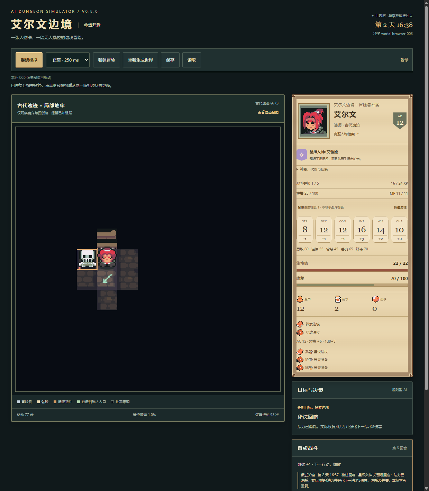

# AI Dungeon Simulator v0.9.0 · 命运编织

一名拥有性格与目标的冒险者，在艾尔文边境自主旅行、处理事件、探索地牢、战斗与成长。你是观察者，创建角色后无需控制移动或攻击。原生HTML/CSS/JavaScript与Canvas，无注册、后端、付费API、CDN或运行依赖。

[在线游玩](https://chen-yy2008.github.io/ai-dungeon-simulator/) · [仓库](https://github.com/chen-yy2008/ai-dungeon-simulator) · [版本记录](CHANGELOG.md) · [本版验收](docs/releases/v0.9-report.md)

## 30秒上手
1. 打开在线网址，或桌面Chrome/Edge直接打开index.html（支持file://）。
2. 输入姓名，选择战士/游荡者/法师，调整五种性格和初始目标，点击创建。
3. 角色自动准备、离镇、进入遗迹、治疗、战斗和撤退。可暂停、调速；手机底部切换地图/人物/纪事。
4. 更多操作提供保存、读取、新建和重开；角色详情查看信仰、装备、技能、关系与记忆。

推荐探索目标、默认性格、种子world-browser-003、快速播放。相同版本/种子/初始设定可复现，播放速度与游戏时间分离。每25动作、暂停和退出自动保存，手动存取同一localStorage槽；读取后暂停。存储受浏览器策略限制，无云同步。

## v0.9人与因果
商队营地的救援/付费/牟利/放弃、三座实际碑文与入口法阵的封印/净化/取能、最后一封信的归还/隐瞒/牟利/拒绝，均需实际到达与后续在场回访。关系改变药水/住宿价格、委托开放、情报优先级和有限危机援助，安全商路降低逐格旅行疲劳。三条线继承已有商队/测绘/旅馆委托，不重置旧世界。

原创史官「鸦羽」提供首次可跳过/重看的七段文本教程：欢迎→职业神明→位置/时间/暂停→居民记忆→实际判定→成长装备→保存/传记。教程独立本地存储，必要暂停后恢复之前播放状态。持续旁白只是事实的模板视图，九类事件有变体，不发奖、不耗规则随机数，不使用LLM或语音。

个人传记保留关键事实ID/时间，按六章节归档，超出长日志上限也保留关键节点。称号按死亡→守护→秘法→逐利→幸存优先级决定。三线完成后回镇收束；1500动作后开始实际撤离并返镇作为兜底，未完成任务如实记为未完成。高级设定可选择持续观察，不自动收束。默认种子三职业约830～920动作结束；倍速改变现实播放时长，不伪造事件。

[三线状态转移与后果](docs/story-transitions.md) · [v0.9验收截图](docs/releases/v0.9-report.md)

## v0.8真实规则
|职业|神明|技能|神迹|
|---|---|---|---|
|战士|赤誓之神·瓦尔铎|盾击削弱命中、守护姿态减伤|不屈誓言：格挡反击或致死保留1HP|
|游荡者|夜途之神·诺克斯|背刺额外1d6、灵巧脱离+4|影步：沿已知退路紧急脱离|
|法师|星织女神·艾蕾娅|奥术飞弹稳定伤害、霜缚术削弱命中|秘法回响：恢复至多5MP并强化下一法术|

技能消耗有限体力或MP，休息恢复；首次法术减耗1。神眷0～100，实际到达小镇神龛或已知地牢入口才能每日祈祷；符合信条的行动、委托/探索提供有限神眷。神迹消耗35、每场一次。发行版采用原创神明名称与徽记，不声称D&D授权。

战斗等级1～5，累计XP门槛0/24/65/120/200，击杀、成功事件、委托和探索各有唯一来源。按性格/职业自动选择生命、命中或技能成长。三装备槽、每职业三候选装备影响命中、伤害、AC、生命、调查或治疗；商店保留生存预算，宝箱成功开启/成功委托才发装备，AI比较效用换装。人物卡显示真实资源与关键战斗回顾；动画可关闭。

普通攻击d20+攻击≥AC命中；自然1失手，20双倍伤害骰。初始战士HP30/AC15、游荡者26/14、法师22/12。骷髅HP10/AC12/攻击+3/1d6+1，静止、发现后相邻自动交战；世界盗匪与哨兵沿用原规则。魔法明确不掷攻击骰，使用药水/防御/神迹会交出行动，死亡停止。

## 保留的世界与探索
小镇、森林、随机连通25×25遗迹；公开道路可观察移动，地牢AI仅依据自身和四邻观察、BFS前往已知探索边缘，迷雾不泄露未知怪物。四NPC按小时在场，关系与五条有限跨日委托、14原事件、商人救助→回镇后续、金币/药水/疲劳/战利品均保留。低资源有免费铺位，撤退沿已知地面回入口再沿道路返镇。怪物/宝箱/XP不刷新刷奖。

## 角色卡与存档
高级设定可编辑六维、设定等级1～20、背景、价值观与行为权重，并导入/导出JSON。当前角色卡schema=ai-dungeon-character、version=2（绑定patronId），兼容[version1示例](docs/examples/character-v1.json)，自动补职业神明。未知字段/越界/运行HP金币等被拒绝；文字纯文本呈现。设定等级是背景，实际战斗等级另算；自由文本不执行技能。

冒险存档延续format3/localStorage键，旧v0.3/v0.6数据补默认神明/装备/成长，保留时间/物资/历史/随机源，错误数据不替换当前冒险。不同版本规则变化不保证跨版本完全同轨。

## 架构
- core.js：连通地牢、已知地图Explorer、d20与回合结算。
- world.js：World/Character/Agent/Simulation、时间/旅行/合法状态变更/存档。
- events.js、living-world.js：有限事件、NPC日程/关系与跨日委托。
- story-rules.js、narrative.js、tutorial.js：有限主线/终局、只读史官/传记、独立教程。
- progression.js：数据驱动神明/装备/技能/成长，由Simulation调用。
- character-card.js、card-editor.js：纯角色设定、校验、编辑/导出。
- assets.js、view.js、legacy-view.js：本地图集、相机/缓存/动画、加载失败后备。
- script.js、index.html、style.css：单计时器、控件与安全文本呈现。

Agent结合性格、目标、风险、资源、关系与经历评分，并使用种子控制少量扰动；它是规则系统，不是LLM。UI/叙事/动画不改变世界、不消费世界随机数。

## 测试与发布
运行不需要Node；开发使用Node22+，执行node tests/check.cjs、node tests/world.cjs、node tests/fate.cjs、node tests/story.cjs及tests内UI/角色/NPC/素材/Pages检查。node tests/browser.cjs使用本机Chrome/Edge、独立忽略配置与原生CDP，BROWSER_PATH指定浏览器；BROWSER_FILE=1另验file://。截图/依赖临时资料在忽略目录，正式证据见docs。Windows PowerShell保护测试：powershell -NoProfile -File tests/publish.ps1。具体实际计数和未验证范围见各[版本报告](docs/releases/)。

正式发布遵循[AGENTS](AGENTS.md)和[发布指南](docs/PUBLISHING.md)：准确文件白名单→安全/测试门禁→提交/注释Tag→原子推送→Actions→Pages SHA/HTTP/在线浏览器核验，不强推。

## 素材与局限
22张CC0 PNG约186KiB，来自官方Ninja Adventure（Pixel-Boy/AAA）与Kenney Fantasy UI Borders；全部本地托管。[授权/来源](docs/ASSETS.md)、[致谢](docs/CREDITS.md)、[v0.6/v0.7真实对比](docs/visual-comparison/README.md)。新增神徽/反馈原创Canvas/CSS，不使用官方游戏立绘。

世界道路固定、NPC按日程换点非连续寻路；单目标简化规则，装备/事件有限；三主线与阶段结局均已实现；开场预设与分享界面按有限队列留待v1.0。历史最多2000条，本地单存档槽，无云同步/多人/外部角色搜索/LLM。已验证Windows Chrome/Edge及390px模拟触屏，未实际验证iOS/Safari或真实手机硬件。
