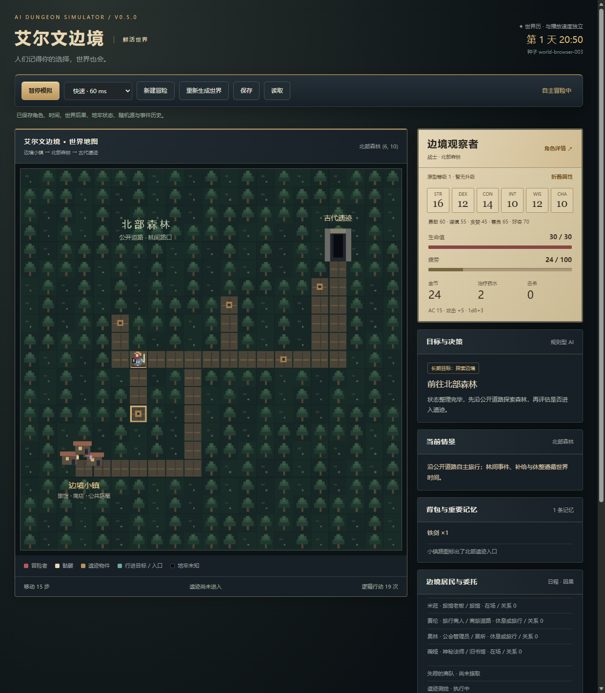
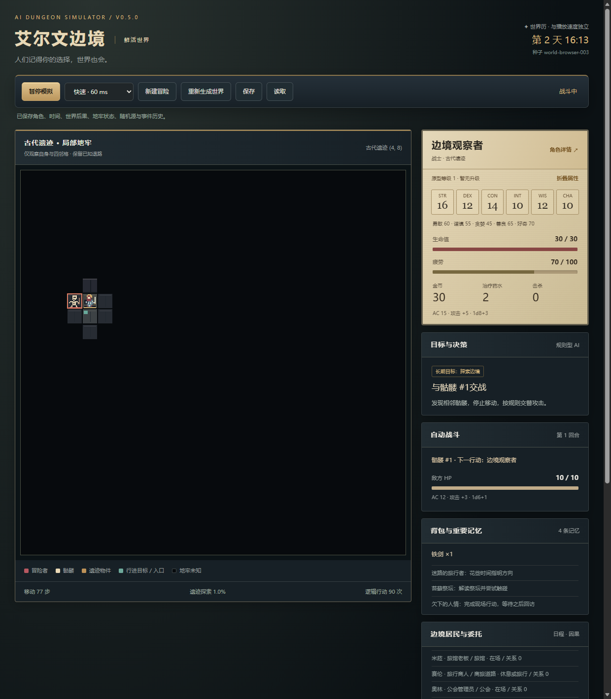

# AI Dungeon Simulator v0.5.0 · 鲜活世界

v0.5 新增米菈（旅馆）、赛伦（商旅）、奥林（公会）、薇娅（法师）的真实日程、在场条件、关系与记忆，以及失踪商队、遗迹测绘、道路威胁、药剂研究、欠下人情五条有限分支链。行动/调查/实际战斗结束后至少过一个游戏日，角色再与在场 NPC 回访才结算后果。原商人救助仍保留并遵循返镇与市集时间。NPC 关系与已接受委托进入评分；疲劳和生命安全仍优先。

Pages 已采用官方 gh-pages 分支式部署：仅经测试的正式标签运行文件进入站点，main 日常提交不更新网站。v0.4.0 的 HTTP version.json 已核对标签源 SHA；在线 Chrome 全交互检查通过。自定义 Actions 模板仍保留，workflow 补充授权过期，未绕过权限写入工作流。 在线体验：https://chen-yy2008.github.io/ai-dungeon-simulator/

v0.4 重制观察界面：原创羊皮纸人物卡、六维属性、折叠详情、故事/事实/骰子三类有限记录、逐格视觉过渡及窄屏排版。六维暂不重算原有战斗参数，等级 1 明确为原型占位，没有经验升级。v0.3 存档在读取时补齐新字段，保留时间、战斗与随机源。

正式基准版本号为 **v0.3.0**。后续正式版本的自动提交、标签与推送规范见 [AGENTS.md](AGENTS.md)、[发布指南](docs/PUBLISHING.md) 和 [CHANGELOG.md](CHANGELOG.md)。发布脚本为 `scripts/publish.ps1`，审核文件清单与版本保存在 `release.json`。

GitHub 公开仓库：[chen-yy2008/ai-dungeon-simulator](https://github.com/chen-yy2008/ai-dungeon-simulator)。

**一名拥有性格与目标的冒险者，在拥有时间、地点、资源与事件后果的世界里自主冒险。**

艾尔文边境是一个原创的小型奇幻世界。玩家创建一名角色，随后作为旁观者观看它准备物资、穿行森林、处理事件、探索古代地牢、战斗、撤退休息和继续旅行。

使用 HTML5、CSS3、原生 JavaScript 和 Canvas 2D。没有后端、数据库、npm 运行依赖、构建流程、外部图片、字体、CDN、LLM 或付费 API。所有像素角色与地图图形由项目自行绘制，不使用商业游戏官方素材。



## 启动与体验

直接用桌面 **Chrome 或 Edge 打开 `index.html`**。普通脚本按顺序加载，支持 `file://`，不需要本地服务器。

1. 在创建界面输入姓名，选择战士、游荡者或法师，调整五种性格权重和初始目标。
2. 点击「创建并开始冒险」，模拟器自动接管移动、选择、交易和战斗。
3. 观察角色离开小镇、在世界地图逐格移动、进入遗迹后切换到带迷雾的地下城。
4. 可随时暂停、继续或调整慢速 / 正常 / 快速播放。每次实际行动推进的游戏时间不受播放速度影响。
5. 右侧显示生命、疲劳、金币、药水、背包、记忆、目标与重要决策原因；下方提供叙事和规则事实两类记录。
6. 「角色详情」可查看完整记忆，「浏览冒险历史」按页查看最近 2000 条记录。

想快速观察完整循环，可使用战士、默认性格、探索目标与种子 **`world-browser-003`**，切换为快速播放。同一版本、同一角色配置和同一种子可以重现相同逻辑结果；暂停、画面和播放速度不会消耗游戏随机数。

「新建冒险」打开创建界面，并暂停当前冒险；取消后可以继续原角色。「重新生成世界」保留初始角色配置，使用新的种子从小镇重新开始，清空本次世界、地牢、资源变化和历史。死亡后模拟停止，可以通过这两种方式重新开始。没有自动上传或 GitHub 推送功能；整个目录可作为普通静态网页提交到仓库或 GitHub Pages。

## v0.3 完成的功能

- **三个区域**：安全的边境小镇、可观察移动的北部森林、沿用 v0.2 的古代遗迹。
- **持续世界时间**：天、小时、分钟；移动、攻击、事件、休息、交易和调查各有时间成本。
- **单角色创建**：三种职业原型；勇敢、谨慎、贪婪、善良、好奇五项独立 0～100 数值，可以同时存在。
- **规则型自主决策**：结合性格、目标、生命、疲劳、物资、已知地点、职业调查能力和历史受伤经历，进行风险评估与效用评分。
- **14 种数据驱动事件**：包含多行动选择、资源前置条件、d20 调查判定、成功/失败结果及持久世界标记。
- **商人因果链**：帮助或无视受伤商人，保存选择；之后达到时间条件并实际回镇，才会出现不同后续。
- **经济与生存循环**：购买药水、使用药水、出售战利品、付费休息、疲劳控制，以及每日有限恢复的森林资源。
- **遗迹持续性**：3～5 只静止骷髅、3 个事件物件；怪物、宝箱、迷雾和探索进度在撤退后保留，不无限刷奖。
- **真实撤退**：使用已观察地面寻路回入口，再沿世界道路回镇；战斗中可以治疗或进行脱离检定。
- **记忆与双轨日志**：世界记录保留实际骰点、行动和状态变化；叙事模板只描述已经发生的事。
- **本地存取和复现**：保存角色、世界、地牢、战斗回合、事件历史及随机数状态，恢复后暂停等待继续。

## 世界与资源规则

### 边境小镇

冒险者出生在小镇（世界坐标 3,16），带有 **24 金币与 2 瓶药水**。小镇提供公开道路图，角色可以获取遗迹入口信息。回镇后先处理已经满足条件的商人后续，再出售战利品、休息与补充药水。

- 治疗药水售价 **8 金币**；得到商人的感谢后降为 **6 金币**。
- 每瓶恢复 **最多 12 HP**，不超过最大 HP；使用消耗药水与 5 分钟。
- AI 通常将药水补充到 2 瓶；不足购买费用时不会继续购买。
- 旅馆收费 **6 金币**，休息 **8 小时**，恢复生命与疲劳。
- 金币不足时可使用免费公共铺位，耗时 **10 小时**。这是生存兜底，避免贫穷角色永远困在小镇。
- 背包中有价格的战利品在小镇售出；初始武器价值为 0，不会被自动出售。本版没有装备槽或装备属性升级。

### 北部森林

世界地图是 21 × 21 的固定道路网络，角色实际逐格行走，每格花费 **10 分钟**并增加 **1.5 疲劳**。道路来自小镇公开路图，角色可以知道道路；遗迹入口在获取信息后才显示。道路之外的森林是装饰性地形，本版不实现自由穿越。

角色会选择林间路口调查，路口有 **240 分钟冷却**，避免两个地点无意义反复往返。独立事件每世界只结算一次。事件用尽后可采集林间草药并带回小镇出售；森林资源最多 3 份，每跨过一天恢复 2 份，因此不能无限无条件采集。

角色夜晚已有疲劳、生命过低或疲劳过高时会回镇。完成一轮准备后一定离开小镇。撤退过的未完成遗迹会成为再次出发的直接目的地，减少沿途疲劳，防止谨慎角色反复进入又退出而没有探索进展。

### 古代遗迹

沿用原有 25 × 25 连通房间与走廊、BFS 寻路、仅自身与四邻格的观察，以及战争迷雾。生成器掌握真实地图，探索器只读已经观察到的地图。

地牢移动花费 **2 分钟**并增加 **0.25 疲劳**。骷髅只在进入局部视野后被发现，相邻时自动战斗；不会穿过活骷髅。宝箱 / 侧室 / 补给匣同样只有进入视野才被发现，相邻时 AI 选择处理方式。

撤退时保留地牢状态并实际走回入口；再次进入从入口开始，利用已有探索信息。走遍全部可达地面后只领取一次 **18 金币和遗迹印章**，随后返回世界地图。已探索遗迹不再重复进入刷奖，但角色会继续在森林与小镇之间生活。

## 角色与战斗

| 职业原型 | HP | AC | 攻击 | 伤害 | 调查加值 | 脱离加值 |
| --- | --- | --- | --- | --- | --- | --- |
| 战士 | 30 | 15 | +5 | 1d8+3 | +2 | +2 |
| 游荡者 | 26 | 14 | +5 | 1d6+4 | +5 | +6 |
| 法师 | 22 | 12 | +5 | 1d8+3 | +7 | +4 |

法师暂时只使用普通攻击，**不实现法术系统**。职业区别体现在基础战斗、事件调查和脱离能力，性格与目标仍会共同影响行为。

骷髅沿用 v0.2：**HP 10、AC 12、攻击 +3、伤害 1d6+1**。森林盗匪为 HP 12，其余参数与骷髅相同。

- 攻击检定：d20 + 攻击加值 ≥ 目标 AC 即命中。
- 自然 1 必定失手；自然 20 必定命中，伤害骰数量翻倍，固定加值只加一次。
- 冒险者固定先手，双方交替行动；每次攻击推进 1 分钟，增加 0.5 疲劳。
- 使用药水占用自己的行动，随后轮到敌人；击败敌人后不会再受到它的反击。
- 战斗脱离：d20 + 职业脱离加值 ≥ DC 12。解读安全退路石碑后额外 +1。成功后沿已知路线撤退；失败后轮到敌人。
- 多只相邻骷髅依次交战，不实现群体战斗或完整先攻系统。
- 每个敌人只在第一次死亡时给予 4～8 金币及一件可出售战利品；角色 HP 归零，本次模拟立即结束。

## AI 决策与扩展接口

`Agent` 是纯规则与评分系统，不具备语言模型理解能力。它输出行动和原因，由 `Simulation` 执行合法性检查及实际规则结算。

- 生命风险阈值由谨慎、勇敢、贪婪、生存目标和受伤记忆共同决定。
- 疲劳和低生命会提高撤退优先级；有药水且生命不足时可以先治疗。
- 事件行动按多项性格权重、财富目标、当前风险和职业调查加值评分，不是“一种性格对应一种固定行为”。
- 每次评分有固定种子控制的少量扰动，相近选项可以不同，但重大安全规则仍优先。
- 整理物资、购买、出发、夜间返回、目标达成后的转换使用明确条件规则作为兜底。
- 财富目标达到当前 100 金币、生存目标平安度过三天后，会记录达成并转为继续探索。

未来可以在 `Agent.decide(observation, random)` / `Agent.eventAction(...)` 边界替换决策来源，也可以在 `createCharacter(config)` 前增加角色卡转换器。当前没有外部角色搜索、网络导入或 LLM API，未来决策适配器仍应只返回建议行动，不能直接修改世界数据。

## 事件与因果机制

`events.js` 定义 14 条事件：受伤商人、商人回镇、钱袋、马车、祭坛、盗匪、旅行者、石碑、补给箱、药剂、流浪商贩、诅咒宝箱、隐藏房间和遗迹补给匣。

每条内容包含唯一 ID、地点、描述、权重、允许条件、行动、费用和后果；调查行动还定义 DC 与成功/失败后果。`EventEngine` 只筛选和产生结算结果；`Simulation` 统一应用费用、生命、金币、物品、知识、记忆与标记，再写入记录。完成标记防止重复结算。

商人事件链如下：

```text
森林遇见受伤商人
  → AI 选择帮助（花金币 / 药水）或无视
  → 保存选择与“120 分钟之后”的后续条件
  → 游戏时间到达条件 + 角色实际回到小镇
  → 再次相遇
  → 帮助者得到 14 金币与药水折扣；无视者没有报酬
```

最初遭遇不会提前输出回镇剧情或奖励。存档保留选择、时间条件与结算标记，所以跨保存也能继续因果链。安全退路信息、受伤经历、被诅咒 / 药剂伤害等重要记忆也会影响以后判断。

叙事与事实来自同一条结算记录，绘图和日志不会掷骰，也不会增添未发生的行动、装备或 NPC。移动画面每步更新，但日志只记录区域变化、决策、事件、交易、休息、战斗等有意义的行为。

## 系统架构与文件结构

```text
ai-dungeon-simulator/
├── index.html        # 页面、角色创建、详情与历史对话框
├── style.css         # 暗黑奇幻界面与像素显示
├── core.js           # 复用 v0.2 地牢、Explorer、骷髅与 Combat 判定
├── events.js         # 数据驱动事件目录与 EventEngine
├── world.js          # World、Character 工厂、Agent、Simulation、随机源与存档
├── view.js           # Canvas 地图与原有像素角色，仅绘图
├── script.js         # UI 绑定、单计时器、localStorage 与日志呈现
├── README.md
├── .gitignore
├── docs/
│   ├── preview.png   # 世界地图实际运行截图
│   └── dungeon.png   # 遗迹战斗实际运行截图
└── tests/
    ├── check.cjs     # 保留 v0.1/v0.2 算法回归检查
    ├── world.cjs     # v0.3 无界面模拟、因果、存档与不变量检查
    └── browser.cjs   # 无 npm 依赖的本机浏览器交互检查
```

`World` 保存世界地图、时间、资源和标记；角色保存自身属性、知识和记忆；`Agent` 提供行动；`EventEngine` / 原有攻击函数负责规则结果；`Simulation` 协调实际状态变化；`view.js` 与 UI 只读取结果。职责分离但没有引入复杂框架、服务容器或后台服务。



## 本地保存与恢复

「保存」使用 localStorage，自动保存发生在每 25 次逻辑行动、暂停、死亡及离开页面时。未开始的新世界不会覆盖旧存档；开始或创建新角色后，后续自动保存会替换这个浏览器中的同一存档槽。

恢复包含角色、世界时间、关键标记、事件、完整地牢状态、正在进行的战斗回合、历史与伪随机数状态。读取后总是暂停，可从原随机源状态继续。存档带 `version: 3`，读取时验证版本、数值、位置、地牢和基本一致性；错误或不兼容的数据不会替换当前冒险。

首次打开页面时，如需读取旧冒险，先关闭创建弹窗，再点击「读取」。`file://` 本地存储受浏览器策略影响，移动项目文件或换浏览器可能无法读到原存档；禁用存储或空间不足时有界面提示，正常模拟仍可运行。不提供云端同步、跨版本迁移、存档导入导出或多存档槽。

## 测试

正常打开页面不需要 Node.js。开发检查可在项目目录执行：

```sh
node --check core.js
node --check events.js
node --check world.js
node --check view.js
node --check script.js
node tests/check.cjs
node tests/world.cjs
```

可选的浏览器检查使用 Node.js 22+ 和本机 Chrome 或 Edge，不安装 npm 包：

```sh
node tests/browser.cjs
```

脚本自动寻找浏览器，可通过 `BROWSER_PATH` 指定可执行文件。它用 DevTools 管道、独立浏览器配置和 `file://` 打开页面；注入虚拟时钟加速测试，并单独验证真实计时器。死亡分支使用合法受伤战斗夹具确定性覆盖，不依赖偶然骰点。截图、测试浏览器配置保存在被 Git 忽略的 `test-output/`。

2026-10-13 实际执行结果：

- 原有 300 张地图连通性、局部观察、移动合法性、完整探索与终止检查通过。
- 原有 300 轮带战斗模拟及自然 1/20、AC、伤害骰等检查通过。
- v0.3 **120 组职业 / 性格 / 目标 / 种子组合，共 590671 次逻辑行动**通过；全部进入遗迹，118 组完成遗迹，2 组自然死亡。存活组均运行到 5000 次行动。这不是游戏胜率的保证。
- 覆盖全部 14 种事件；额外检查每个行动及判定分支、商人的帮助与无视后续、低资源兜底、死亡停止、非法存档拒绝、固定种子和存取后继续的一致性。
- Chrome 与 Edge 实测通过：角色创建、可观察移动、世界/地牢切换、骷髅战斗、暂停/调速、1500 次连续逻辑行动、返回世界、商人后续、详情/历史、保存/读取/刷新恢复、重置、死亡停止、三职业和真实计时器暂停。

未专项验证其他浏览器、其他操作系统、手机、后台标签页时序或跨浏览器存档。后台标签页可能降低实际播放频率，但不会改变一次逻辑行动的游戏时间成本。

## 当前局限与后续方向

- 世界地图与道路固定，地牢才随机生成；不实现庞大开放世界、自由穿越、天气或动态 NPC 社会。
- 事件内容有限且每世界只结算一次；全部体验后仍可进行有限资源采集、交易与休息，但不会无限生成新剧情。
- 原有 BFS 不保证整轮探索总路程最短；战斗简化为单目标、固定冒险者先手，没有完整 D&D 5e 规则。
- 战利品可出售，初始职业武器固定；没有等级、装备槽、职业成长、法术、多角色、网络角色导入或 LLM。
- 角色逐格移动，区域切换仅使用轻量 CSS 淡入；没有复杂战斗动画。
- 历史最多保留最近 2000 条，并明确显示移出的记录数量；不是无限日志数据库。
- 本地存档只有一个槽，按当前版本恢复，没有云同步或版本迁移。

后续可以扩展事件目录、世界资源与时间后果，比较不同 Agent 策略，再逐步加入更多角色能力。优先保持“观察 → 决策 → 规则判定 → 状态变化 → 忠实记录”的边界。
