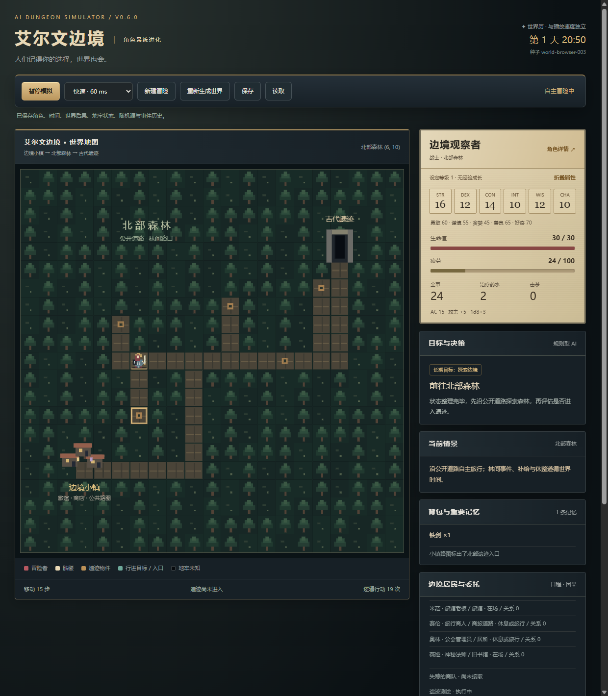
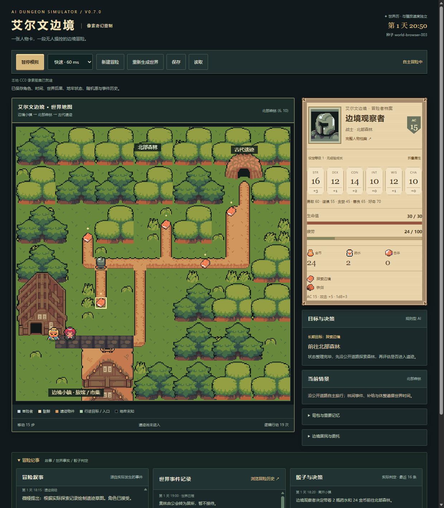
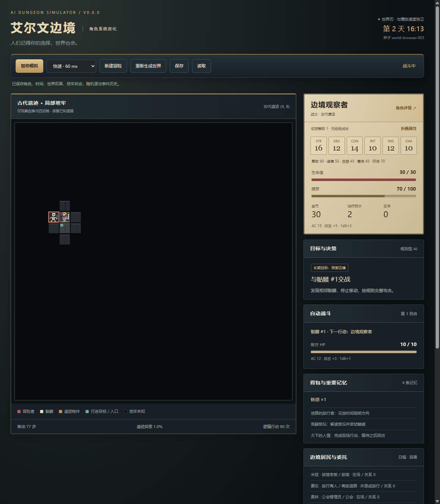
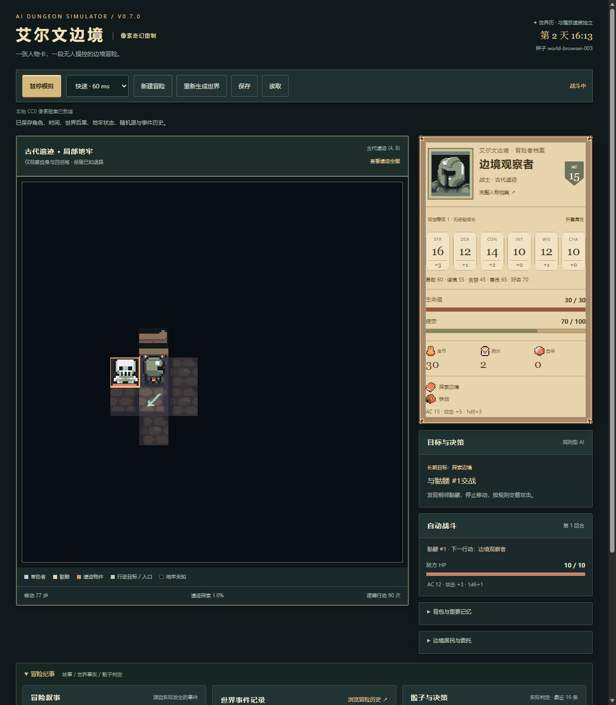
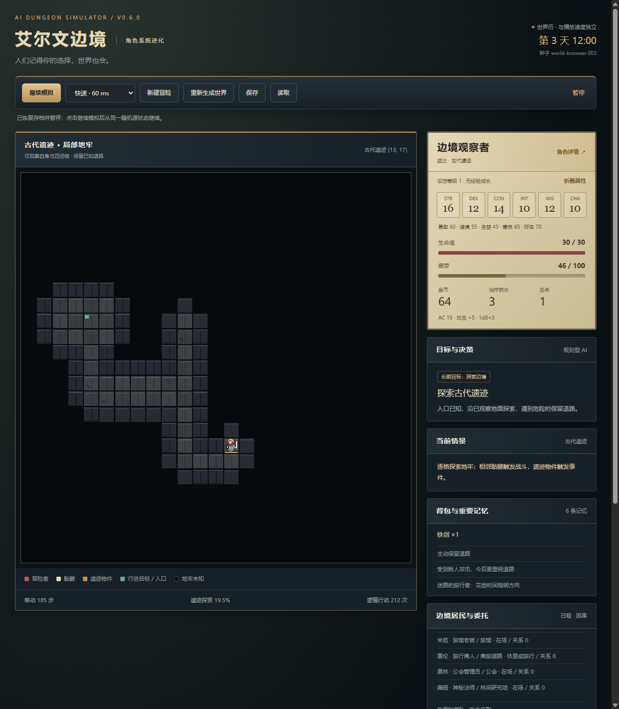
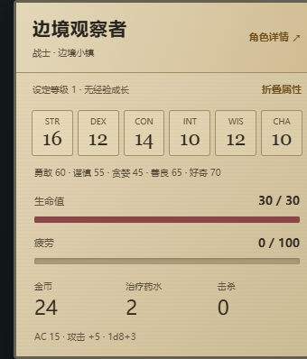
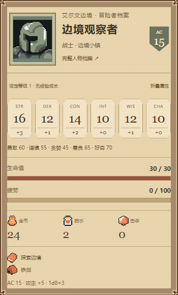
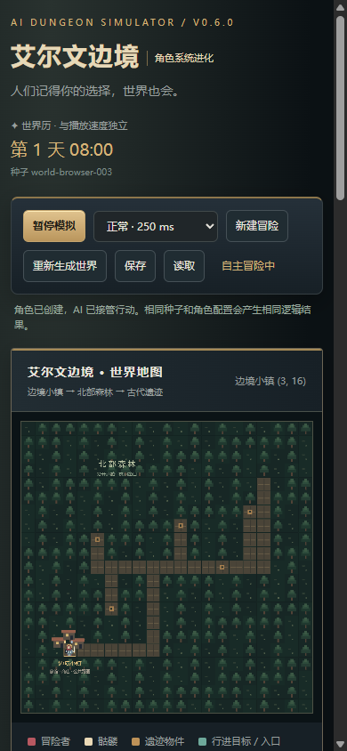
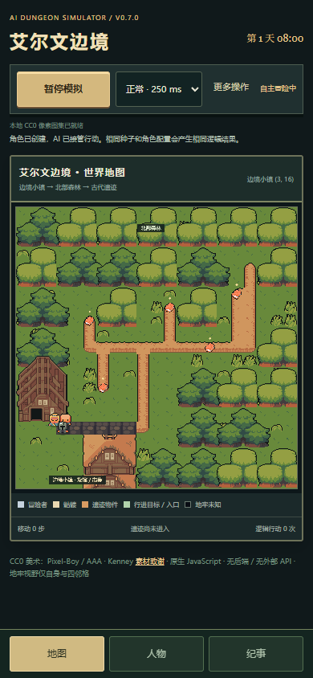

# v0.6 / v0.7 真实浏览器比较

均使用 world-browser-003、战士、默认权重，1240×1420 桌面视口；手机390×844。旧版从正式 v0.6.0 标签解包后实际浏览器运行，新版来自当前工作分支。世界画面在同样18次 tick后（19个逻辑行动）；首战同样触发骷髅；深入画面基于实际规则续演至40个已走格（进度19.5%），没有合成场景或手动伪造奖励。v0.7 默认地牢局部镜头，数据依然25×25，另可查看全图。人物卡在出生状态截取 DOM 实际边界。

| 画面 | v0.6 | v0.7 |
| --- | --- | --- |
| 世界 |  |  |
| 首战 |  |  |
| 深入地牢 |  |  |
| 人物卡 |  |  |
| 手机 |  |  |

生成方式：COMPARE_VERSION=v06/v07 node tests/browser.cjs；旧版指定 BROWSER_URL 为本地正式标签解包页面。只有指定比较模式才写 docs，其余发布测试只写忽略的 test-output。图像是浏览器原生 PNG，未以修图替换画面。
